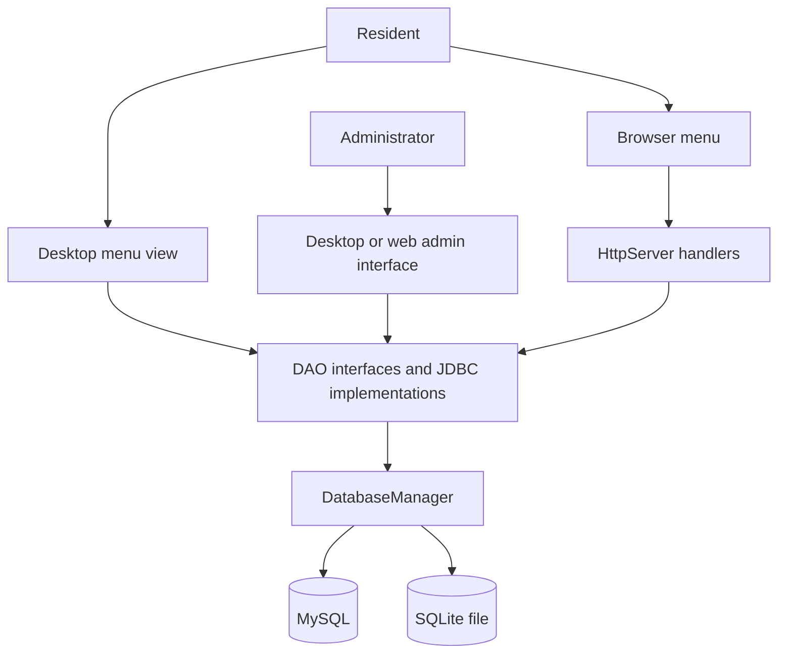
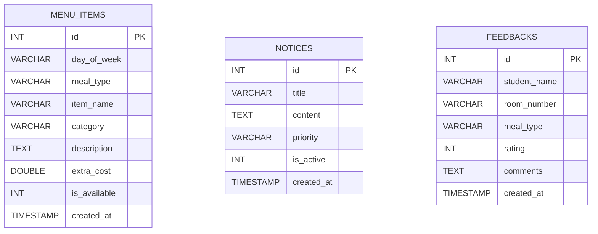

# Technical Documentation
## Hostel Mess Daily Menu Register

### 1. Project Overview

- **Problem statement:** Mess menus are often shared through paper notices or boards. These are inconvenient to update and difficult for residents to check remotely.
- **Background:** This project provides a digital weekly menu register for hostel mess staff and residents.
- **Purpose:** Allow an administrator to maintain menu records and allow residents to view the menu by day through a desktop or browser interface.

### 2. Objectives

- **Main objectives:** Accept and manage menu information, save it in a database, and retrieve it for display and search.
- **Expected outcomes:** Administrators can add, edit, and delete menu items. Residents can view meals for a selected day, including dish descriptions, categories, and extra costs when applicable.

### 3. Requirements

#### Functional Requirements

- Accept menu details through the desktop admin form: day, meal type, dish name, category, description or side dishes, extra cost, and availability.
- Validate that a dish name is present and that the extra cost is numeric in the desktop form.
- Store multiple menu records persistently in MySQL or SQLite. The application does not impose a fixed menu-record limit; practical capacity depends on the selected database.
- Create, read, update, and delete menu records.
- Filter menu records by day and meal, and search by dish name, category, description, or day.
- Display matching menu records in the desktop and web interfaces and report admin operation status.
- Define database tables and DAO operations for notices and feedback. These are not integrated as user-facing workflows in the main menu interface.

#### Non-Functional Requirements

- **Portability:** Java application; database access is through JDBC. SQLite is available for local use, and a MySQL server can be used instead.
- **Usability:** Provides a Java Swing desktop interface and a browser-based menu interface.
- **Maintainability:** Separates model, DAO, database, view, web, utility, and exception code into packages.
- **Security limitation:** The demonstration admin credentials are hard-coded, and web login uses one in-memory global flag rather than individual sessions. Do not expose the admin interface publicly without replacing this authentication design.
- **Persistence:** Records survive normal application restarts when the configured database is persistent. A container requires mounted storage if SQLite data must survive container replacement.

### 4. Technology Stack

| Technology | Use in this project |
| --- | --- |
| Java (JDK 17+) | Application language and runtime; the Dockerfile uses Eclipse Temurin JDK 17. |
| Swing / AWT | Desktop user interface. |
| JDBC | Database connectivity and prepared SQL statements. |
| MySQL | Optional server database; the checked-in configuration selects MySQL at `localhost:3306`. |
| XAMPP | Optional way to run a local MySQL server; it is not bundled or required by the application. |
| SQLite | Local file database used when selected or when a MySQL connection fails. |
| MySQL Connector/J and SQLite JDBC | Database driver JARs in `lib/`. |
| `com.sun.net.httpserver.HttpServer` | Built-in Java HTTP server for the browser interface. |
| HTML / CSS | Browser pages generated by the Java web server. |
| Docker | Optional headless server packaging using the included `Dockerfile`. |
| Batch / PowerShell | Windows launch scripts. |

### 5. System Architecture



- **Presentation layer:** Swing views display the menu and provide the desktop admin form. The web server generates HTML pages and handles browser requests.
- **Request and event handling:** Swing action listeners and HTTP handlers collect input and invoke DAO methods. There is no separate service/controller package.
- **Data access layer:** `MenuDAO`, `NoticeDAO`, and `FeedbackDAO` define operations; their `*DAOImpl` classes execute SQL.
- **Database layer:** `DatabaseManager` loads configuration, manages the JDBC connection, creates tables, and seeds the initial menu when the menu table is empty.

### 6. Project Structure

```text
src/com/hostel/mess/
  AppMain.java                 Application startup
  TestVerification.java        Standalone database/DAO verification harness
  dao/                         DAO interfaces and JDBC implementations
  database/DatabaseManager.java Database configuration, connection, and schema setup
  exception/                   Database and validation exceptions
  model/                       MenuItem, MealType, Notice, Feedback, BaseEntity
  util/                        Shared constants and Swing helpers
  view/                        Swing windows, forms, and dialogs
  web/MessWebServer.java       HTTP routes and generated browser pages
lib/                           MySQL, SQLite, and logging JARs
db.properties                  Database configuration
run.bat                        Windows desktop launcher
run_web_browser.bat            Windows launcher that opens the browser menu
run.ps1                        PowerShell desktop launcher
Dockerfile                     Headless server container definition
```

Important classes:

| Class | Responsibility |
| --- | --- |
| `AppMain` | Initializes the database and web server, then opens the Swing application unless headless/server-only mode is requested. |
| `MainAppFrame` | Main combined desktop interface, including the resident menu and admin panel. |
| `MenuItem` | Menu record model; extends `BaseEntity`. |
| `MenuDAO` / `MenuDAOImpl` | Menu persistence, CRUD, filtering, search, and count operations. |
| `DatabaseManager` | Singleton database manager; creates the schema and seeds sample menu data. |
| `MessWebServer` | Serves the public menu and admin HTTP routes. |
| `TestVerification` | Exercises selected database and DAO operations. |

### 7. Database Design

The application creates the following tables. `id` is the auto-incrementing primary key in each table. There are no foreign-key relationships between these tables.

| Table | Columns |
| --- | --- |
| `menu_items` | `id` (PK), `day_of_week`, `meal_type`, `item_name`, `category`, `description`, `extra_cost`, `is_available`, `created_at` |
| `notices` | `id` (PK), `title`, `content`, `priority`, `is_active`, `created_at` |
| `feedbacks` | `id` (PK), `student_name`, `room_number`, `meal_type`, `rating`, `comments`, `created_at` |



The database manager uses MySQL `INT AUTO_INCREMENT PRIMARY KEY` or SQLite `INTEGER PRIMARY KEY AUTOINCREMENT` syntax. The menu table is seeded with sample records only when it is empty. Configure MySQL/SQLite selection and connection values in `db.properties`; `MYSQL_HOST` and related environment variables can override the MySQL connection settings.

### 8. System Modules

1. **Resident menu module:** Select a day and view the day's meals. The desktop menu also supports dish search.
2. **Admin menu module:** Authenticate, filter and search records, then add, edit, or delete menu items. The desktop form includes availability; the browser form does not expose every desktop field.
3. **Database module:** Creates the schema, selects MySQL or SQLite, seeds initial menu data, and persists DAO operations.
4. **Web module:** Serves the public menu and admin login/menu-management routes over HTTP.
5. **Notice and feedback data module:** Provides models, tables, and DAO operations. These are present in the source but are not connected to the primary user-facing menu flow.

### 9. Application Workflow

1. An administrator enters or edits menu details in the desktop form or browser admin form.
2. The desktop form checks for a dish name and parses the extra cost. The web handler also requires a non-empty dish name and parses the cost, defaulting to zero if parsing fails.
3. The UI or HTTP handler creates a `MenuItem` and calls a menu DAO operation.
4. The DAO executes a prepared SQL statement through `DatabaseManager` against the selected database.
5. After successful changes, the desktop interface reloads menu data; web requests redirect to the admin page with a status message.
6. Resident menu queries retrieve records by day and meal. Search queries match dish name, category, description, or day.
7. Results are rendered as meal lists/cards in the client interface and as records in the admin table.

### 10. Implementation Details

- **Object-oriented design:** Model fields are encapsulated; `MenuItem`, `Notice`, and `Feedback` inherit shared identity/timestamp behavior from `BaseEntity`. `MealType` is an enum.
- **Abstraction and polymorphism:** DAO interfaces separate persistence contracts from JDBC implementations. Menu DAO methods provide different read/filter operations.
- **Singleton:** `DatabaseManager.getInstance()` provides the shared database manager.
- **JDBC and CRUD:** DAO implementations use JDBC statements and prepared statements for create, read, update, and delete operations. Values supplied to queries are bound as parameters.
- **Exception handling:** Database operations report failures using `MessDatabaseException`; `ValidationException` is defined for validation-related errors. The UI catches and reports database or input errors.
- **Validation scope:** Current validation is basic. It does not constitute comprehensive input validation or production-grade security, particularly for browser-submitted values.

### 11. Testing

`TestVerification.java` is a standalone database/DAO harness. The results below describe expected behavior; the actual result is marked not run because the harness has not been executed as part of this documentation update.

| Test case in harness | Expected result | Actual result |
| --- | --- | --- |
| Database initialization and menu read | Database connection is available and menu data can be read. The harness expects seeded menu items. | Not run. |
| Menu search | Searching for `Malabar Chicken` returns a matching menu item when the seeded/test data is present. | Not run. |
| Menu create, read, update, and delete | A test menu item is inserted, retrieved, updated, and deleted. | Not run. |
| Notices and feedback DAO operations | Active notices can be retrieved; a feedback row can be inserted and an average rating queried. | Not run. |

Run after compiling, for example after `run.bat` has compiled the project:

```powershell
java -ea -cp "lib/*;bin" com.hostel.mess.TestVerification
```

The harness writes a feedback record to the configured database. Use a disposable or backed-up database; do not treat it as a read-only check. Some results are printed rather than asserted by the harness, so a printed `PASS` is not equivalent to comprehensive automated test coverage.

### 12. Setup & Execution

**Requirements**

- JDK 17 or later.
- To use MySQL, a running MySQL server. XAMPP is one optional way to provide it.
- The required JDBC driver JARs are included in `lib/`.

**Database setup and configuration**

- The checked-in `db.properties` selects MySQL at `localhost:3306`, database `hostel_mess_db`, username `root`, with an empty password.
- MySQL connection settings can be changed in `db.properties`. If `MYSQL_HOST` is set, the application uses the MySQL environment variables documented in the Database Configuration section of `TECHNICAL_DOCUMENTATION.md`'s source implementation, `DatabaseManager`.
- To use SQLite directly, set `db.type=sqlite`. The file `hostel_mess.db` is created in the process working directory.
- If the selected MySQL connection cannot be opened, the application falls back to SQLite.
- Startup creates the tables automatically and seeds the menu table when it has no records.

**Run on Windows**

```bat
run.bat
```

Launches the desktop application; the embedded web server also starts. To open the web interface automatically:

```bat
run_web_browser.bat
```

The public menu is at `http://localhost:8080/`; the admin page is at `http://localhost:8080/admin`. The PowerShell desktop launcher is `run.ps1`.

**Run with Docker**

```sh
docker build -t hostel-mess .
docker run --rm -p 8080:8080 hostel-mess
```

The container runs in headless server mode. Mount persistent storage if SQLite data must survive container replacement.

### 13. Team Contributions

Fill in this table with the actual project contributors and their work. No names or registration numbers are present in the source files.

| Name | Register No. | email|
| --- | --- | --- |
| MOHAMMED SINAN MK | MEA25CS091 | 25gcs54@meaec.edu.in |
| SHIVAK V | MEA25CS123 | 25gcs01@gmail.com |
| SHARIQUE MOHAMMED P | 26MLCS06 | 26mlcs06@meaec.edu.in |

### 14. Limitations

- Admin credentials are hard-coded in `AppConstants`.
- Web admin authentication uses a single process-wide boolean rather than per-user sessions; it is not appropriate for public deployment.
- The web menu and admin forms do not expose all the same fields as the desktop form.
- Input validation is limited and should be strengthened, especially for HTTP requests.
- The database schema has no foreign keys or migration/versioning mechanism.
- SQLite data in an unmounted Docker container may be lost when the container is replaced.
- The verification harness writes test data to the configured database and has limited assertions.

### 15. Future Enhancements

- Replace the demonstration login with secure password storage, per-user sessions, and appropriate web security controls.
- Add comprehensive validation and clearer feedback for invalid browser and desktop input.
- Complete the notice and feedback user workflows if they are required product features.
- Add database migrations, backup/restore support, and constraints where appropriate.
- Improve test isolation so verification can run against a temporary database without modifying user data.
- Align the desktop and web admin capabilities and add user/role management if needed.

### 16. References

- Project source: `src/com/hostel/mess/`.
- Database configuration: `db.properties`.
- Windows launchers: `run.bat`, `run_web_browser.bat`, and `run.ps1`.
- Container definition: `Dockerfile`.
- Project setup and launch summary: [README.md](README.md).
- Java SE 17 API documentation: [https://docs.oracle.com/en/java/javase/17/docs/api/](https://docs.oracle.com/en/java/javase/17/docs/api/).
- MySQL Connector/J documentation: [https://dev.mysql.com/doc/connector-j/en/](https://dev.mysql.com/doc/connector-j/en/).
